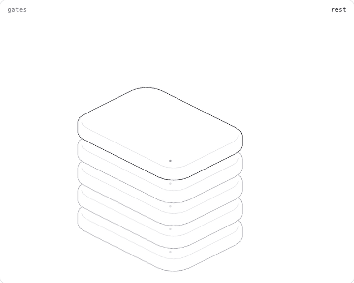

<div align="center">



# ProofLoop

**Your coding agent says "done." ProofLoop makes it prove it.**

A Claude Code plugin that wraps every change in a plan you approve, gates that must pass on the exact commit, and an evidence trail you can audit.

[](LICENSE)
[](https://www.npmjs.com/package/@vamsiivarmaa/proofloop)


</div>

---

## The problem

Agents are confident. A green summary is not a green build. Typical failures:

- "All tests pass" — the test was quietly weakened.
- "Bug fixed" — nobody reproduced the bug first.
- "Done" — the edit touched files nobody asked it to touch.
- The run dies halfway and you start over, with no record of what was real.

## What ProofLoop does

```
describe ─► plan + acceptance criteria ─► YOU approve the plan hash ─► implement in a worktree
                                                                              │
         PR with the evidence ◄── review ◄── gates: PASS │ FAIL │ BLOCKED ◄───┘
```

| You get | How |
|---|---|
| **No code before you approve** | Approval is bound to the exact plan hash and only a `human:` actor can record it. Agents cannot approve or change state. |
| **"Verified" means a gate passed on the head commit** | Missing, skipped or stale gates are never a pass. Evidence is checksummed, append-only and HMAC-signed. |
| **Tests can't be weakened to go green** | A `test-integrity` gate catches deleted, skipped or loosened tests. |
| **Bugs are reproduced before they are fixed** | The bug protocol demands a failing regression test first, then proof it now passes. |
| **Scope stays in scope** | Out-of-scope edits are reverted; risky commands need scoped approval. |
| **Crashes don't cost you the run** | Interrupted runs reconcile with Git and resume instead of restarting. |
| **A report that says what is *not* proven** | Limits and blocked items are listed, not hidden. |

The rules are enforced in code (a state machine, a command policy, a PreToolUse hook), not in prompts an agent can talk its way around.

## Install

**From the Claude Code marketplace** (Claude Code 2.1.275 or later):

```text
/plugin marketplace add vamsivarma27/proofloop
/plugin install proofloop@proofloop
```

**Or load it straight from a clone:**

```bash
git clone https://github.com/vamsivarma27/proofloop && cd proofloop
claude --plugin-dir "$PWD"
```

**Or as a CLI** (the plugin's engine, usable on its own):

```bash
npm i -g @vamsiivarmaa/proofloop@next
proofloop --help
```

Needs Node ≥ 22.13, Git, and optionally an authenticated `gh` for issues and PRs.

## Try it in a new project

```text
/proofloop:setup                              read-only self-check
/proofloop:feature Add pagination to the users page
                                              → plan, acceptance criteria, risk, gate preview
/proofloop:approve <run-id>                   you review the plan hash
proofloop run <run-id>                        implement, verify, review, open a PR
/proofloop:status
```

Other protocols: `:bug`, `:diagnose`, `:performance`, `:verify`, and `:start-project` (idea → researched blueprint → roadmap issues).

## Honest numbers

ProofLoop does not promise bug-free software. What has been measured:

- A 22-task evaluation with a **scripted** agent (it tests the harness, not model quality): the harness delivered 100% of tasks that should ship and stopped on 100% that should not; the no-harness baseline falsely reported done on 32%.
- A small **real-model** run (10 tasks, one run per arm, $9.47): the harness and the bare model both verified 70%; false delivery 22% vs 30%; the harness was about 4x slower. That is **no demonstrated advantage yet**, and two bug tasks are unexplained. Details in [evals/reports/real-model.md](evals/reports/real-model.md).
- Cloudflare Code Mode bridge: off by default, tested only against a local mock.
- Security review so far is AI-only. A human review is still open — see [the threat model](docs/security/threat-model.md).

## Docs

[Architecture](docs/architecture/overview.md) · [Threat model](docs/security/threat-model.md) · [Protocol authoring](docs/guides/protocol-authoring.md) · [Adapters](docs/guides/adapters.md) · [Troubleshooting](docs/guides/troubleshooting.md) · [Evaluation](docs/guides/evals.md) · [Decisions](docs/decisions/) · [Release status](docs/plans/release-status.md) · [Getting started](GETTING_STARTED.md) · [Contributing](CONTRIBUTING.md)

## Develop

```bash
pnpm install && pnpm check      # typecheck, lint, tests with coverage, build
./bin/proofloop eval            # scripted evaluation suite
```

The hero figure is an interactive [Hairline](https://github.com/lucasmarkes/hairline)-style figure: open [docs/assets/gates-figure.html](docs/assets/gates-figure.html) in a browser and move the pointer over the plates.

## License

Apache-2.0. See [LICENSE](LICENSE).
